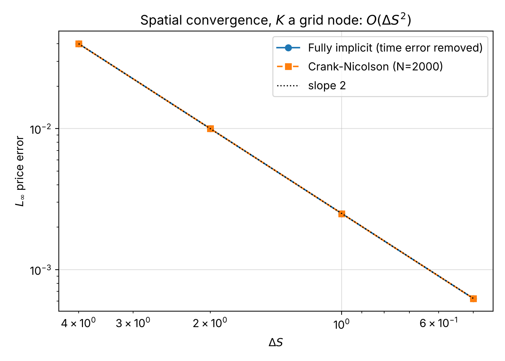
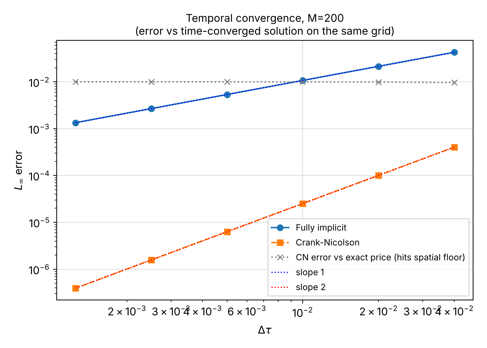
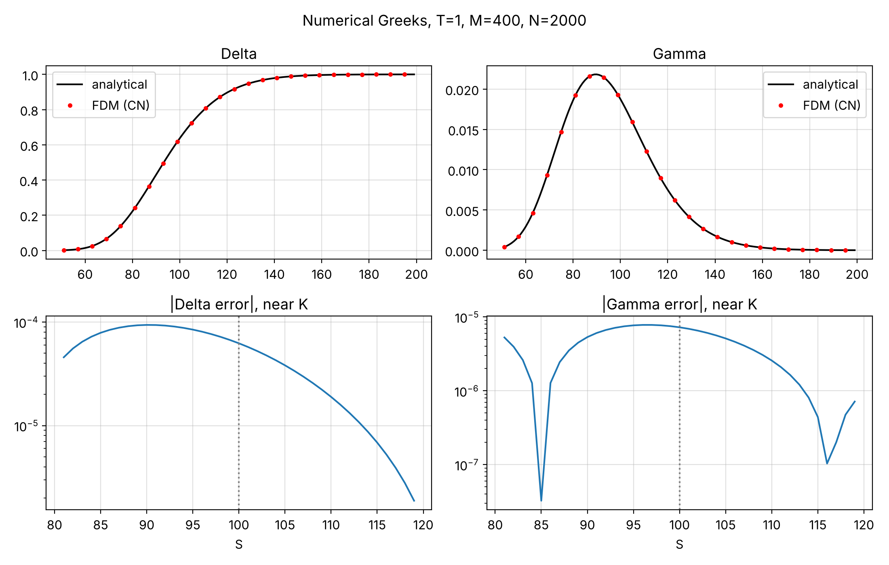
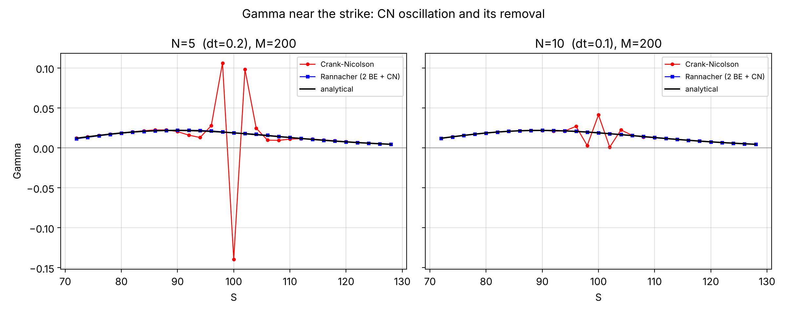
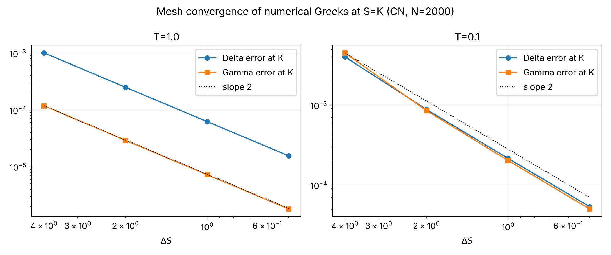

# Numerical Black–Scholes PDE using Finite Differences

**Course Project:** Numerical Partial Differential Equations in Finance  
**Student:** Akshat Kumar  
**Supervisor:** Dr. Ashok Kumar Vaikuntam  
**Course Coordinator:** Prof. Arshad Javed  
**Institution:** BITS Pilani  

---

## Overview

This repository contains the numerical implementation and analysis of finite difference methods for solving the one-dimensional Black–Scholes partial differential equation (PDE) for European option pricing. 

The project evaluates two implicit time-stepping schemes:
1. **Fully Implicit Method (Backward Euler):** Unconditionally stable, first-order accurate in time O(Δτ), second-order accurate in space O(ΔS²).
2. **Crank–Nicolson Method (θ = 1/2):** Unconditionally stable, second-order accurate in time O(Δτ²), second-order accurate in space O(ΔS²).

The study includes systematic spatial and temporal refinement studies, observed orders of convergence, numerical Greeks (Delta and Gamma), and the treatment of the non-smooth payoff kink using Rannacher time-stepping.

---

## Mathematical Formulation

Under the Black–Scholes framework, the option price V(S, t) satisfies:

∂V/∂t + (1/2) σ² S² (∂²V/∂S²) + r S (∂V/∂S) - r V = 0,   (S, t) ∈ (0, S_max) × [0, T)

Transforming to time-to-maturity τ = T - t yields the forward parabolic problem:

∂V/∂τ = (1/2) σ² S² (∂²V/∂S²) + r S (∂V/∂S) - r V ≡ L_BS V

### Boundary and Terminal Conditions (European Call)
- Terminal condition (τ = 0): V(S, 0) = max(S - K, 0)
- Lower boundary (S = 0): V(0, τ) = 0
- Upper boundary (S = S_max, S_max ≥ 4K): V(S_max, τ) ≈ S_max - K exp(-r τ)

### Spatial Discretisation
Using a uniform grid S_j = j ΔS for j = 0, 1, ..., M with ΔS = S_max / M, second-order central difference approximations are applied:

∂²V/∂S²|_j = (V_{j+1} - 2 V_j + V_{j-1}) / ΔS² + O(ΔS²)  
∂V/∂S|_j   = (V_{j+1} - V_{j-1}) / (2 ΔS) + O(ΔS²)

This defines the discrete spatial operator:

L_BS^h V_j = α_j V_{j-1} + β_j V_j + γ_j V_{j+1}

where:
- α_j = (σ² S_j²) / (2 ΔS²) - (r S_j) / (2 ΔS)
- β_j = - (σ² S_j²) / ΔS² - r
- γ_j = (σ² S_j²) / (2 ΔS²) + (r S_j) / (2 ΔS)

The resulting tridiagonal system at each time step is strictly diagonally dominant and is solved in O(M) operations using the Thomas algorithm.

---

## Numerical Verification and Convergence Analysis

Benchmark: K = 100, T = 1, r = 0.05, σ = 0.20, S_max = 400 (European call; puts are checked in `results/output_8_convergence_study.txt`). Analytical ATM call = 10.45058357, put = 5.57352602.
**Every number below is produced by `python reproduce_all_results.py` and is stored in `results/`.** Errors are L∞ over interior grid nodes unless stated; observed order p = log₂(E_h / E_h/2).

### 1. Price verification (M = 200)

| Scheme | N | ATM call error | ATM put error |
|:--|--:|--:|--:|
| Fully implicit | 1000 | 1.095e-02 | 1.083e-02 |
| Crank–Nicolson | 500 | 9.897e-03 | 9.897e-03 |

Full tables for S ∈ [60, 200], call and put, are in `results/output_8_convergence_study.txt` (section A).

### 2. Spatial convergence (time error removed)

Crank–Nicolson with N = 2000; fully implicit with Richardson extrapolation in time (2V_N − V_N/2) so that its O(Δτ) term does not contaminate the measurement. Both schemes share the same spatial operator and give the same spatial errors. Grids with K on a node (M a multiple of 4):

| M | ΔS | Implicit L∞ | order | CN L∞ | order | CN L2 | CN error at S=K | order |
|--:|--:|--:|--:|--:|--:|--:|--:|--:|
| 100 | 4.00 | 4.000e-02 | — | 4.000e-02 | — | 2.068e-01 | 3.982e-02 | — |
| 200 | 2.00 | 1.001e-02 | 2.00 | 1.001e-02 | 2.00 | 5.157e-02 | 9.898e-03 | 2.01 |
| 400 | 1.00 | 2.499e-03 | 2.00 | 2.499e-03 | 2.00 | 1.288e-02 | 2.471e-03 | 2.00 |
| 800 | 0.50 | 6.246e-04 | 2.00 | 6.245e-04 | 2.00 | 3.220e-03 | 6.175e-04 | 2.00 |

**Result: p = 2.00 for both schemes, in L∞, L2 and at S = K.** (The pair M = 50 → 100 is not a refinement within one family, because K is half-way between nodes for M = 50; it is excluded. See Derivation 8.)

### 3. Temporal convergence (same-grid reference)

Temporal error = difference to a time-converged CN solution (N = 12800) **on the same spatial grid**, so the spatial error cancels. M = 200:

| N | Δτ | Implicit | order | CN | order | CN error vs exact price |
|--:|--:|--:|--:|--:|--:|--:|
| 25 | 0.04000 | 4.287e-02 | — | 4.035e-04 | — | 9.634e-03 |
| 50 | 0.02000 | 2.147e-02 | 1.00 | 1.010e-04 | 2.00 | 9.915e-03 |
| 100 | 0.01000 | 1.074e-02 | 1.00 | 2.524e-05 | 2.00 | 9.985e-03 |
| 200 | 0.00500 | 5.372e-03 | 1.00 | 6.310e-06 | 2.00 | 1.000e-02 |
| 400 | 0.00250 | 2.686e-03 | 1.00 | 1.576e-06 | 2.00 | 1.001e-02 |
| 800 | 0.00125 | 1.343e-03 | 1.00 | 3.929e-07 | 2.00 | 1.001e-02 |

**Result: p = 1.00 (fully implicit) and p = 2.00 (Crank–Nicolson)**; the same orders are obtained for M = 100 (`results/output_8_convergence_study.txt`, section C). The last column shows why the temporal error must not be measured against the exact price: the CN error stops decreasing at the spatial-error floor of the grid (~1e-2 at M = 200).

### 4. Grid-refinement matrix, M, N ∈ {50, 100, 200, 400} (L∞ error vs exact price)

Fully implicit:

| M \ N | N=50 | N=100 | N=200 | N=400 |
|:-:|--:|--:|--:|--:|
| **M=50** | 6.955e-02 | 6.250e-02 | 5.894e-02 | 5.715e-02 |
| **M=100** | 6.109e-02 | 5.046e-02 | 4.514e-02 | 4.248e-02 |
| **M=200** | 3.110e-02 | 2.042e-02 | 1.516e-02 | 1.253e-02 |
| **M=400** | 2.382e-02 | 1.312e-02 | 7.765e-03 | 5.104e-03 |

Crank–Nicolson:

| M \ N | N=50 | N=100 | N=200 | N=400 |
|:-:|--:|--:|--:|--:|
| **M=50** | 5.530e-02 | 5.534e-02 | 5.535e-02 | 5.535e-02 |
| **M=100** | 3.992e-02 | 3.998e-02 | 4.000e-02 | 4.000e-02 |
| **M=200** | 9.915e-03 | 9.985e-03 | 1.000e-02 | 1.001e-02 |
| **M=400** | 2.408e-03 | 2.475e-03 | 2.493e-03 | 2.497e-03 |

Doubling M and N together mixes both error sources, so the diagonal is not a clean order measurement (use sections 2–3).

---

## Numerical Greeks

Δⱼ = (Vⱼ₊₁ − Vⱼ₋₁) / (2ΔS), Γⱼ = (Vⱼ₊₁ − 2Vⱼ + Vⱼ₋₁) / ΔS², computed from the FDM price vector and compared with N(d₁) and n(d₁)/(Sσ√T).

At S = K, T = 1, M = 400, N = 2000 (Crank–Nicolson): Δ error 6.24e-05 (exact 0.636831), Γ error 7.25e-06 (exact 0.018762). Full table over S ∈ [60, 200], implicit and CN: `results/output_9_numerical_greeks.txt`.

Mesh refinement of the Greek errors at S = K (CN, N = 2000).

T = 1 (kink width σ√T·K = 20):

| M | ΔS | Δ error at K | order | Γ error at K | order |
|--:|--:|--:|--:|--:|--:|
| 100 | 4.00 | 1.010e-03 | — | 1.184e-04 | — |
| 200 | 2.00 | 2.500e-04 | 2.01 | 2.911e-05 | 2.02 |
| 400 | 1.00 | 6.236e-05 | 2.00 | 7.248e-06 | 2.01 |
| 800 | 0.50 | 1.558e-05 | 2.00 | 1.810e-06 | 2.00 |

T = 0.1 (kink width 6.3; the kink has had little time to diffuse):

| M | ΔS | Δ error at K | order | Γ error at K | order |
|--:|--:|--:|--:|--:|--:|
| 100 | 4.00 | 4.009e-03 | — | 4.501e-03 | — |
| 200 | 2.00 | 8.837e-04 | 2.18 | 8.530e-04 | 2.40 |
| 400 | 1.00 | 2.162e-04 | 2.03 | 2.036e-04 | 2.07 |
| 800 | 0.50 | 5.378e-05 | 2.01 | 5.035e-05 | 2.02 |

Both Greeks converge with order 2. For short maturities the error near the strike is large on coarse grids (Γ error ≈ 7% of Γ at ΔS = 4, T = 0.1) and is governed by ΔS relative to the kink width.

---

## Treatment of the Payoff Kink, CN Oscillations and Rannacher Start-up

**Strike position.** Refining within a family of grids with K on a node, or with K half-way between nodes, both give p → 2; the position of K only changes the error constant (the half-way grid is ≈3× more accurate at equal ΔS). This corrects an earlier claim that an off-node strike degrades the order to O(ΔS).

**CN oscillations.** CN is A-stable but not L-stable, so the high-frequency content of the kink is not damped. With M = 200, T = 1 and few time steps, CN gives a *negative* Gamma near K. Rannacher start-up (2 backward-Euler steps of size Δτ, then CN) removes it. λ = Δτ σ² K² / ΔS².

T = 1, M = 200:

| N | Δτ | CN price err | Rannacher price err | CN Γ err | Rannacher Γ err | CN min Γ |
|--:|--:|--:|--:|--:|--:|--:|
| 3 | 0.3333 | 5.62e-01 | 1.96e-01 | 2.74e-01 | 1.63e-03 | -0.2550 |
| 5 | 0.2000 | 2.39e-01 | 7.89e-02 | 1.58e-01 | 6.55e-04 | -0.1394 |
| 10 | 0.1000 | 3.39e-02 | 2.76e-02 | 2.24e-02 | 2.64e-04 | 0.0009 |
| 20 | 0.0500 | 9.45e-03 | 1.44e-02 | 4.93e-05 | 6.09e-05 | 0.0129 |
| 50 | 0.0200 | 9.91e-03 | 1.07e-02 | 3.01e-05 | 3.62e-05 | 0.0129 |
| 200 | 0.0050 | 1.00e-02 | 1.01e-02 | 3.13e-05 | 3.17e-05 | 0.0129 |

T = 0.1, M = 200:

| N | Δτ | CN price err | Rannacher price err | CN Γ err | Rannacher Γ err | CN min Γ |
|--:|--:|--:|--:|--:|--:|--:|
| 3 | 0.0333 | 4.45e-02 | 8.44e-02 | 2.58e-02 | 5.48e-03 | 0.0159 |
| 5 | 0.0200 | 2.84e-02 | 5.27e-02 | 7.42e-04 | 2.00e-03 | 0.0153 |
| 10 | 0.0100 | 3.13e-02 | 3.75e-02 | 7.45e-04 | 1.21e-03 | 0.0152 |
| 20 | 0.0050 | 3.19e-02 | 3.35e-02 | 8.26e-04 | 9.46e-04 | 0.0152 |
| 50 | 0.0020 | 3.21e-02 | 3.24e-02 | 8.49e-04 | 8.69e-04 | 0.0152 |
| 200 | 0.0005 | 3.21e-02 | 3.22e-02 | 8.53e-04 | 8.54e-04 | 0.0152 |

* For λ ≳ 10 (N ≤ 10 at T = 1) CN oscillates; Rannacher reduces the Gamma error by a factor ≈ 170 (N = 3), 240 (N = 5), 85 (N = 10).
* For small Δτ CN does not oscillate and Rannacher gives no benefit; at intermediate N it is slightly *less* accurate in price (e.g. 1.4e-2 vs 9.4e-3 at N = 20, T = 1). At T = 0.1 with these step sizes CN does not oscillate and Rannacher increases the price error for N ≤ 20.
* Rannacher is therefore a remedy for large Δτ/ΔS², not a universal improvement.

---

## Visual Verification Plots

| Spatial convergence | Temporal convergence |
|:---:|:---:|
|  |  |

| Numerical Greeks | CN oscillation vs Rannacher |
|:---:|:---:|
|  |  |

| Greek mesh convergence |
|:---:|
|  |

---

## Known Limitations

* One parameter set (K = 100, T = 1, r = 0.05, σ = 0.2; T = 0.1 for the Greeks and kink study); European options only; constant coefficients.
* Uniform grid only (no clustering near K); Dirichlet boundary at S_max = 4K, whose truncation error is negligible here but was not studied separately.
* Rannacher = two full backward-Euler steps (not four half steps).
* Technical report: `REPORT.md`. Presentation slides: not yet prepared.

---

## Repository Structure

```
README.md                      this file
REPORT.md                      technical report (derivations, experiments, interpretation)
reproduce_all_results.py       regenerates every table in results/ (and figures with --figures); fails if a check fails
requirements.txt
programs/
  fdm_core.py                  shared solvers: analytical BS, Thomas, implicit / CN / Rannacher, error norms
  convergence_study.py         Weeks 7-8: price tables, spatial & temporal convergence, 4x4 matrix
  numerical_greeks.py          Week 9: numerical Delta/Gamma, mesh refinement
  payoff_kink_cn_oscillation.py  Weeks 10-11: strike position, CN oscillations, Rannacher
  generate_figures.py          figures 1-5
  black_scholes.py, generate_grid.py, finite_difference_derivatives.py, thomas_solver.py   Weeks 1-4
  implicit_fdm.py, crank_nicolson.py   interactive solvers (Weeks 5-6, standalone)
derivations/01 ... 08          mathematical derivations
results/output_8 ... 11, summary.json
figures/fig1 ... fig5
```

## Reproduction

```bash
pip install -r requirements.txt
python reproduce_all_results.py --figures     # ~15 s; exits non-zero if any acceptance check fails
```

The acceptance checks assert that the observed orders match theory (spatial 2, implicit temporal 1, CN temporal 2, Greeks 2), that Thomas agrees with LAPACK, that put-call parity holds for the FDM solution, and that the CN oscillation and its removal by Rannacher are reproduced.
